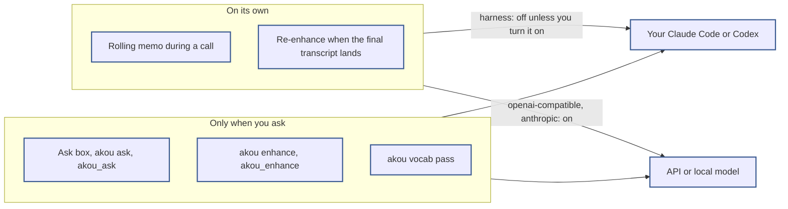

# Providers

A provider is what akou asks when it needs a model: to answer a question in the ask box, to write enhanced notes, to keep the rolling memo during a call, and to run the vocabulary pass after one. akou has no cloud and needs no key of its own. You pick one provider in Settings (`provider.kind`).

| Provider | What it runs | Where your transcript goes |
|---|---|---|
| `harness` (the default) | Your own Claude Code or Codex, installed on this computer | Wherever that program sends it: your subscription with Anthropic or OpenAI |
| `openai-compatible` | A server you name: Ollama, LM Studio, llama.cpp, vLLM, or OpenAI | The address in `provider.baseUrl`. A local model keeps it on your machine |
| `anthropic` | The Anthropic API with your own key | Anthropic, under your API account |
| `command` | A program you name in the config file (`provider.command`), such as a wrapper that picks one of your accounts | Wherever that program sends it |
| `none` | Nothing | Nowhere. Questions get the matching excerpts instead of an answer, and the window's ask box becomes "Search this call" while no agent follows the call |

When the provider cannot answer (the program is missing, a usage limit is reached, you are logged out, or no answer comes within `provider.timeoutSeconds`), akou says why and shows the excerpts it found. It never queues the request or retries it quietly.

## The agent following the call answers first

When an agent follows the call (Claude Code that started or attached to it with the `akou` skill, and keeps its `akou events -f --type ask,… --client claude-code` watch running), a question you type in the ask box goes to that agent first. It answers inside its own conversation, the one where you started the call, on its own login, and posts the same answer back to the box with `akou_answer` or `akou answer`. The box shows it with its citations and "answered by claude-code (the agent following the call)".

- Under the box, one muted line says which agent questions go to before you ask.
- The box waits up to `ask.agentWaitSeconds` (30 s by default) for that answer. If none comes, or no agent is following, the provider above answers as usual, and the box says which route answered or which did not and why. A line like "claude-code did not answer within 30 s. The coding agent akou runs did not answer: usage limit until 01:00." names both.
- An agent's answer that arrives while the provider is still running stops that run, so a second subscription is not spent on a question already answered. One that arrives later is added to the card under its own label; it never replaces what is there.
- With `provider.kind` `none`, the agent is the only route: the box waits with the excerpts shown, and the agent's answer fills it when it comes.
- A question an agent asks (`akou ask`, `akou_ask`) never waits on an agent.
- An agent with no way to wake an idle conversation (Codex today) starts no watch; it finds the questions waiting for it in `akou status`'s `live.unanswered` the next time you talk to it.

## A command of your own

`provider.kind` `command` runs the program in `provider.command`, an argument list run with no shell, instead of akou's own Claude Code or Codex call. Use it when you have several accounts or a wrapper that picks one: akou never chooses an account for you. Plain text goes in and out:

- The prompt goes on standard input, which is then closed. Your program prints the answer on standard output and exits 0.
- `{system}`, `{question}`, `{call}`, `{ask}` and `{task}` (`ask`, `enhance`, `memo`, or `other`) inside an argument are replaced by their values. With no `{system}` argument the system prompt goes at the top of standard input. The same values are in `AKOU_QUESTION`, `AKOU_CALL_ID`, `AKOU_ASK_ID` and `AKOU_TASK`.
- A non-zero exit fails the run, and the last line of standard error is the reason. A usage-limit or login message there reads as one in the window. `provider.timeoutSeconds` applies.
- `provider.commandLabel` is the name the window shows; empty, the program's file name.
- It is set in the config file only, never over the API or from the window, because it decides what runs on your computer. Sessions, resume and starting the program early are not supported.

Examples (`~/.config/akou/config.json`):

```json
{ "provider.kind": "command",
  "provider.command": ["claude", "-p", "--tools", "", "--strict-mcp-config", "--no-session-persistence", "--system-prompt", "{system}"] }
```

```json
{ "provider.kind": "command",
  "provider.command": ["codex", "exec", "--sandbox", "read-only", "--skip-git-repo-check", "--ephemeral", "-"] }
```

A wrapper that picks an account, then runs one of those:

```sh
#!/bin/sh
# ~/bin/akou-ask: answer on the work account
export CLAUDE_CONFIG_DIR="$HOME/.claude-work"
exec claude -p --tools "" --strict-mcp-config --no-session-persistence --system-prompt "$1"
```

with `"provider.command": ["/Users/you/bin/akou-ask", "{system}"]` and `"provider.commandLabel": "Claude (work)"`.

**Which account the harness runs on.** akou's own `harness` call runs on whatever login its environment gives it. An app started from an agent's shell inherits that shell's `CLAUDE_CONFIG_DIR` or `CODEX_HOME`, which may be another account than the one you expect. akou never reads, sets or switches these. It only says so: `akou doctor`, `akou status` and the line for a usage limit or a login failure name the setting the harness ran with, in your window and terminal only, never in the call.

## When akou calls the provider

Nothing runs on your subscription unless you asked, with two exceptions that you can turn off, and neither applies to the harness by default.



| Feature | Runs | With the harness |
|---|---|---|
| Ask | When you press Ask or an agent calls `akou_ask` | Yes, on your request |
| Enhance | When you run `akou enhance` or an agent calls `akou_enhance` (the window does not offer it) | Yes, on your request |
| Vocabulary pass | When you run `akou vocab pass` on a call that has ended (the window fixes words on their line instead) | Yes, on your request |
| Rolling memo | After at least 3 minutes and 1,500 tokens of new speech, every time | Off unless `memo.provider` is `on` |
| Re-enhance after the final layer | Once, when the final transcript lands after notes were written from the live one | Never on its own: run `akou enhance` again (the window does not offer it) |

`memo.provider` is `auto` by default: on for `openai-compatible` and `anthropic`, off for `harness` and `command`, because it would spend your subscription every few minutes while you are not looking. Set it to `off` to stop it for every provider. An agent following the call can still write the memo with `akou_memo_put`.

Re-enhancing is also skipped, in favour of the button, when a person or an agent wrote the notes, because running it would replace their work.

## How the harness is run

akou finds `claude` and `codex` on your `PATH` or through your login shell, or runs the path you pin in `provider.harnessPath`. Each request is one run of the program, with akou's prompt on standard input:

- Claude Code: `claude -p --output-format stream-json --verbose --include-partial-messages --input-format stream-json --tools "" --strict-mcp-config --no-session-persistence --system-prompt …`
- Codex: `codex exec --json --sandbox read-only --skip-git-repo-check --ephemeral -`

Both run in a new empty folder, so no project instructions load. Claude Code gets no tools and none of your MCP servers; Codex runs in a read-only sandbox. The run keeps no session afterwards, so nothing akou asks shows up in your harness's history. The harness still loads your own user-level instructions, memory and skills, as it does for any run.

**Starting early.** When the ask box gets focus, akou starts the harness and leaves it waiting for its prompt, so its start-up runs while you type. It is sent nothing until you ask, and nothing reaches your subscription before then. A harness that gets no question is stopped after a minute, when akou quits, and on its own if akou crashes. `akou ask` and agents start the harness when the question arrives, as before.

akou never logs in for you, never reads or copies the harness's credentials, and never changes its settings.

## Session reuse (off)

`provider.harnessResume` keeps one Claude Code session per call for follow-up questions: the first question starts it with `--session-id`, each follow-up continues it with `--resume` and sends only the transcript lines the session has not seen yet, plus the question. It applies only when the whole call fits in one prompt (about the first 45 to 60 minutes), and anything the session was already sent changing (a corrected line, the call ending) starts a new one. Codex always runs fresh. With it on, Claude Code keeps those sessions in its own history.

It ships off, and stays off unless a follow-up question costs at least 40 % fewer tokens with it than without. The measurement:

1. A synthetic call from a fixed seed, short enough for the whole-call prompt.
2. The same questions asked twice through Claude Code, once fresh each time and once in one session, with three new lines added between questions both times.
3. The tokens of each run, as Claude Code reports them in its `result` event: input, cache writes, cache reads and output, all counted. Cache reads count in full because a resumed session carries its whole earlier conversation. Whether that is cheaper on your subscription is the vendor's rule, and akou cannot see it ([the rule in code](https://github.com/GeiserX/akou/blob/main/src/main/llm/reuse.ts)).
4. The first question is left out; the mean over the follow-ups decides.

[`bun scripts/measure-resume.ts --yes`](https://github.com/GeiserX/akou/blob/main/scripts/measure-resume.ts) runs it and prints both lists and the verdict. It spends your subscription, which is why it needs `--yes`. **No measurement has been recorded yet**, so the setting stays off.

## Keys

`provider.apiKey` is for `anthropic` and `openai-compatible`. It is never shown back over the API or in Settings, and never written to a log. Where it is kept depends on the system:

- **macOS**: in your login Keychain, as a generic password with service `akou` and account `provider.apiKey`, never in `config.json`. Saving the key (Settings, `PATCH /config`, or `printf '%s' "$KEY" | akou config set provider.apiKey -`) writes it there, and the assistant reads it from there. akou talks to the Keychain through Apple's `security` command and passes the key on its standard input, never on a command line where `ps` would show it. A key already in `config.json` from an older akou moves into the Keychain the next time akou starts and is removed from the file. If the Keychain refuses (a locked Keychain, for example), the key stays in the file, still works, and akou logs that it did; the next save of the key moves it. A key is printable ASCII with no spaces, since the Keychain gives any other text back changed. You can see or delete the item in Keychain Access under "akou".
- **Windows and Linux**: in `config.json`, which only your user can read. Credential Manager and the Secret Service (libsecret) come later.
- **Server mode** (`akou serve`): in `config.json` on every system; akou never writes it to a Keychain there. On a Mac where the akou app already moved the key into the Keychain, server mode still reads it from there while `config.json` has none, and logs that it belongs in the file.

`provider.harnessPath` can only be set in the file, because it names a program akou runs. `provider.baseUrl` can be set in the file or on the Settings page of the akou window, never over the API, because it decides where your key and transcripts go.

In Settings, the assistant is one of four choices: the Claude Code or Codex akou found on this computer, "Use an API key" (Anthropic, or an OpenAI-compatible server with its address and model), "Local model (Ollama)", which sets `provider.kind` to `openai-compatible` and `provider.baseUrl` to `http://127.0.0.1:11434/v1` and asks for the model's name, or "None". A change of choice or of service clears `provider.model`, since one service's model name means nothing to another. OpenAI-compatible starts at OpenAI's own address, `https://api.openai.com/v1`, which you can change.

## Terms of service: an open risk

Driving your locally installed Claude Code or Codex from another program is the default here, and we have not confirmed that the vendors' consumer terms allow it. We treat this as a risk to check before a release, not as settled.

What we know:

- Both programs have a documented non-interactive mode for scripts (`claude -p`, `codex exec`), and that is what akou uses.
- akou runs them on your computer, under your own login, only when you ask (except what you turn on yourself), with a small prompt that akou builds.
- akou never automates a login, never touches credentials, never shares one subscription between people, and never runs the harness unattended unless you set `memo.provider` to `on`.

What we have not verified:

- Whether the consumer terms of Anthropic ([Consumer Terms](https://www.anthropic.com/legal/consumer-terms), [Usage Policy](https://www.anthropic.com/legal/aup)) and of OpenAI ([Terms of Use](https://openai.com/policies/row-terms-of-use/)) cover a separate application starting their command-line tool for its user, with that user's subscription.
- Whether that changes when the application is distributed to other people, as akou is.
- Whether either vendor limits how often, or how unattended, such runs may be.

Before each release we read the current terms and the tools' own documentation, and record here the date, what they say on these three points, and what we changed because of it. If the terms rule it out, the harness becomes opt-in and the default moves to `none`. The API and local providers work the same way either way, so switching needs no other change.

| Date checked | Anthropic | OpenAI | Change made |
|---|---|---|---|
| 2026-10-03 | Allowed as akou runs it, on our reading; Anthropic has not confirmed it. Third-party apps may not offer Claude.ai login, handle its credentials, or "route requests through Free, Pro, or Max plan credentials on behalf of their users"; a user signing in to the unmodified Claude Code with their own subscription is allowed. Pro and Max limits assume "ordinary, individual usage" | Allowed as akou runs it, on our reading; OpenAI has not confirmed it. The Terms of Use forbid extracting Output "automatically or programmatically" and sharing an account, while Codex's own documentation offers `codex exec --json` for scripts and says it reuses the saved login by default. Open: whether akou reading `codex exec --json` counts as that extraction. No rule names an app that starts Codex for its user | None. The harness stays the default, and the rolling memo stays off for it. One question per vendor stays open (below) |
| 2026-10-10 | Allowed as akou runs it, on our reading; Anthropic has not confirmed it. Unchanged since 2026-10-03 except one thing: a new Usage Policy, published now and effective 12 November 2026, forbids to "resell, proxy, or otherwise provide access to Claude through unauthorized means, including services that route requests through consumer subscriptions". akou gives nobody access they lack: it starts the user's own Claude Code for that user. A stricter reading could count it, which sharpens the open question | Allowed as akou runs it, on our reading; OpenAI has not confirmed it. Nothing changed since 2026-10-03: same Terms of Use, Usage Policies and Codex pages, same open question | None. The harness stays the default, and the rolling memo stays off for it. Both questions stay open, and Anthropic's now names the new Usage Policy clause (below) |
| 2026-10-12 | Allowed as akou runs it, on our reading; Anthropic has not confirmed it. Nothing changed since 2026-10-10: the same Claude Code page, the same EEA Consumer Terms of 8 October 2025 and the same Usage Policy effective 12 November 2026, each read directly. The Consumer Terms outside the EEA were not re-read: only a web archive copy serves that version, and the archive was offline | Allowed as akou runs it, on our reading; OpenAI has not confirmed it. Nothing changed since 2026-10-10: the Terms of Use effective 1 January 2026, the Europe Terms of Use updated 16 January 2026 and the Usage Policies effective 29 October 2025, this time read directly in a browser, still forbid extracting Output "automatically or programmatically" and sharing account credentials; Codex's pages still offer `codex exec --json` and reuse the saved login. Same open question | None. The harness stays the default, and the rolling memo stays off for it. Both questions stay open |
| 2026-10-13 | Allowed as akou runs it, on our reading; Anthropic has not confirmed it. Nothing changed since 2026-10-12: the Claude Code page matches a web archive copy of 12 October word for word, the Usage Policy is still the one effective 12 November 2026, and both Consumer Terms are still the versions effective 8 October 2025. This time the version outside the EEA was read too, through a web archive copy of 13 October 2026 | Allowed as akou runs it, on our reading; OpenAI has not confirmed it. Nothing changed since 2026-10-12: the same Terms of Use, Europe Terms of Use and Usage Policies, read in a browser, and the same Codex pages. Not a change, but missed by the earlier readings: since at least 29 September 2026 OpenAI documents "ChatGPT plan usage for open-source and locally hosted apps" through Sign in with ChatGPT, where the app registers its own OAuth client. It says nothing about the route akou takes, starting `codex exec` on Codex's own saved login. Same open question, with a documented alternative beside it | None. The harness stays the default, and the rolling memo stays off for it. Both questions stay open. Moving the Codex harness to Sign in with ChatGPT is recorded as an option, not decided |
| 2026-10-18 | Allowed as akou runs it, on our reading; Anthropic has not confirmed it. Nothing changed since 2026-10-13: the Claude Code page, read directly, is identical to the web archive copy of 12 October 2026; the Usage Policy is still the one effective 12 November 2026, and against a web archive copy of 18 October 2026 only the footer differs; both Consumer Terms are still the versions effective 8 October 2025, the EEA one read directly and the one outside the EEA through a web archive copy of 18 October 2026 | Allowed as akou runs it, on our reading; OpenAI has not confirmed it. Nothing changed since 2026-10-13: the Terms of Use effective 1 January 2026, the Europe Terms of Use updated 16 January 2026 and the Usage Policies effective 29 October 2025, read in a browser, keep every clause quoted on 2026-10-03; the Codex and Sign in with ChatGPT pages say the same. One Codex documentation change, not a term: since the copy of 12 October the non-interactive page says `--full-auto` is no longer supported. akou never passed it, so nothing to do. Same open question | None. The harness stays the default, and the rolling memo stays off for it. Both questions stay open |
| 2026-10-21 | Allowed as akou runs it, on our reading; Anthropic has not confirmed it. Nothing changed since 2026-10-18: the Claude Code page, read directly, matches the web archive copy of 12 October 2026 sentence for sentence; the Usage Policy is still the one effective 12 November 2026, and against the web archive copy of 18 October 2026 only the site header and footer differ; both Consumer Terms are still the versions effective 8 October 2025, the EEA one read directly and the one outside the EEA through a web archive copy of 20 October 2026, with the same automated-access and credential-sharing clauses | Allowed as akou runs it, on our reading; OpenAI has not confirmed it. Nothing changed since 2026-10-18: the Terms of Use effective 1 January 2026, the Europe Terms of Use updated 16 January 2026 and the Usage Policies effective 29 October 2025, read in a browser; the Codex non-interactive page still says `codex exec` reuses the saved login, still offers `--json` for scripts and still says `--full-auto` is no longer supported; the Sign in with ChatGPT pages say the same. Same open question | None. The harness stays the default, and the rolling memo stays off for it. Both questions stay open |
| 2026-10-23 | Allowed as akou runs it, on our reading; Anthropic has not confirmed it. Nothing changed since 2026-10-21: the Claude Code page, read directly, matches the web archive copy of 12 October 2026 sentence for sentence; the Usage Policy is still the one effective 12 November 2026, and against the web archive copy of 18 October 2026 only the site header and footer differ; both Consumer Terms are still the versions effective 8 October 2025, the EEA one read directly and the one outside the EEA through a web archive copy of 22 October 2026, with the same automated-access and credential-sharing clauses | Allowed as akou runs it, on our reading; OpenAI has not confirmed it. One change since 2026-10-21: OpenAI published new Usage Policies on 21 October 2026, effective 20 November 2026. They add a ban on using OpenAI models or outputs to train substitute models, widen "automation of high-stakes decisions" to "high-stakes actions", and require prior approval to "operate a model-access intermediary platform or other service that enables third parties to directly access OpenAI models", while saying this "does not apply solely because an application integrates OpenAI models to power its features or functionality". akou trains nothing, automates no high-stakes action, and gives no third party access: it starts the user's own Codex for that user, which is the exempted case. The Terms of Use effective 1 January 2026 and the Europe Terms of Use updated 16 January 2026, read in a browser, keep every clause quoted on 2026-10-03; the Codex non-interactive and Sign in with ChatGPT pages say the same. Same open question | None. The harness stays the default, and the rolling memo stays off for it. Both questions stay open, and OpenAI's now names the new Usage Policies clause (below) |
| 2026-10-24 | Allowed as akou runs it, on our reading; Anthropic has not confirmed it. Nothing changed since 2026-10-23: the Claude Code legal page, read directly, still says Anthropic does not permit third-party developers "to offer Claude.ai login into their own applications, or to route requests through Free, Pro, or Max plan credentials on behalf of their users", still allows "an end user signing in to the unmodified Claude Code binary with their own Claude subscription", and still says Pro and Max limits "assume ordinary, individual usage"; the Usage Policy, read directly, is still the one effective 12 November 2026, with the clause on services "that route requests through consumer subscriptions"; the Consumer Terms, read directly, are still the version effective 8 October 2025, with the same automated-access and credential-sharing clauses | Allowed as akou runs it, on our reading; OpenAI has not confirmed it. Nothing changed since 2026-10-23: the Usage Policies, read in a browser, are still the version effective 20 November 2026, with the same model-access intermediary paragraph and its exemption for "an application integrates OpenAI models to power its features or functionality"; the Terms of Use effective 1 January 2026 and the Europe Terms of Use updated 16 January 2026, read in a browser, keep the clauses on extracting Output "automatically or programmatically" and on sharing account credentials; the Codex non-interactive page, read directly, still says `codex exec` reuses saved CLI authentication by default, still offers `--json` for scripts and still says `--full-auto` is no longer supported. Same open question | None. The harness stays the default, and the rolling memo stays off for it. Both questions stay open |
| 2026-10-25 | Allowed as akou runs it, on our reading; Anthropic has not confirmed it. Nothing changed since 2026-10-24: the Claude Code legal page, read directly, still says Anthropic does not permit third-party developers "to offer Claude.ai login into their own applications, or to route requests through Free, Pro, or Max plan credentials on behalf of their users", still allows "an end user signing in to the unmodified Claude Code binary with their own Claude subscription", and still says Pro and Max limits "assume ordinary, individual usage"; the Usage Policy, read directly, is still the one effective 12 November 2026, with the clause on services "that route requests through consumer subscriptions"; the Consumer Terms, read directly, are still the version effective 8 October 2025, with the same automated-access and credential-sharing clauses | Allowed as akou runs it, on our reading; OpenAI has not confirmed it. Nothing changed since 2026-10-24: the Usage Policies, read in a browser, are still the version effective 20 November 2026, with the same model-access intermediary paragraph and its exemption for "an application integrates OpenAI models to power its features or functionality"; the Terms of Use effective 1 January 2026 and the Europe Terms of Use updated 16 January 2026, read in a browser, keep the clauses on extracting Output "automatically or programmatically" and on sharing account credentials; the Codex non-interactive page, read directly, still says `codex exec` reuses saved CLI authentication by default, still offers `--json` for scripts and still says `--full-auto` is no longer supported. Same open question | None. The harness stays the default, and the rolling memo stays off for it. Both questions stay open |
| 2026-10-26 | Allowed as akou runs it, on our reading; Anthropic has not confirmed it. Nothing changed since 2026-10-25: the Claude Code legal page, read directly, still says Anthropic does not permit third-party developers "to offer Claude.ai login into their own applications, or to route requests through Free, Pro, or Max plan credentials on behalf of their users", still allows "an end user signing in to the unmodified Claude Code binary with their own Claude subscription", and still says Pro and Max limits "assume ordinary, individual usage"; the Usage Policy, read directly, is still the one effective 12 November 2026, with the clause on services "that route requests through consumer subscriptions"; the Consumer Terms, read directly, are still the version effective 8 October 2025, with the same automated-access and credential-sharing clauses | Allowed as akou runs it, on our reading; OpenAI has not confirmed it. Nothing changed since 2026-10-25: the Usage Policies, read in a browser, are still the version effective 20 November 2026, with the same model-access intermediary paragraph and its exemption for "an application integrates OpenAI models to power its features or functionality"; the Terms of Use effective 1 January 2026 and the Europe Terms of Use updated 16 January 2026, read in a browser, keep the clauses on extracting Output "automatically or programmatically" and on sharing account credentials; the Codex non-interactive page, read directly, still says `codex exec` reuses saved CLI authentication by default, still offers `--json` for scripts and still says `--full-auto` is no longer supported. Same open question | None. The harness stays the default, and the rolling memo stays off for it. Both questions stay open |
| 2026-10-28 | Allowed as akou runs it, on our reading; Anthropic has not confirmed it. Nothing changed since 2026-10-26: the Claude Code legal page, read directly and identical in its text to the web archive copies of 24 and 27 October 2026, still says Anthropic does not permit third-party developers "to offer Claude.ai login into their own applications, or to route requests through Free, Pro, or Max plan credentials on behalf of their users", still allows "an end user signing in to the unmodified Claude Code binary with their own Claude subscription", and still says Pro and Max limits "assume ordinary, individual usage"; the Usage Policy, read directly, is still the one effective 12 November 2026, with the clause on services "that route requests through consumer subscriptions"; the Consumer Terms, read directly, are still the version effective 8 October 2025, with the same automated-access and credential-sharing clauses | Allowed as akou runs it, on our reading; OpenAI has not confirmed it. Nothing changed since 2026-10-26: the Usage Policies, read in a browser, are still the version effective 20 November 2026, with no changelog entry after 2026-10-21, with the same model-access intermediary paragraph and its exemption for "an application integrates OpenAI models to power its features or functionality"; the Terms of Use effective 1 January 2026 and the Europe Terms of Use updated 16 January 2026, read in a browser, keep the clauses on extracting Output "automatically or programmatically" and on sharing account credentials; the Codex non-interactive page, read directly, still says `codex exec` reuses saved CLI authentication by default, still offers `--json` for scripts and still says `--full-auto` is no longer supported. Same open question | None. The harness stays the default, and the rolling memo stays off for it. Both questions stay open |
| 2026-10-28 | Allowed as akou runs it, on our reading; Anthropic has not confirmed it. Nothing changed since the first reading of 2026-10-28, made for 1.4.0: the Claude Code legal page, read directly again after v1.4.0 was tagged, is identical in its text to the web archive copy of 27 October 2026 and still says Anthropic does not permit third-party developers "to offer Claude.ai login into their own applications, or to route requests through Free, Pro, or Max plan credentials on behalf of their users", still allows an end user signing in "to the unmodified Claude Code binary with their own Claude subscription", and still says Pro and Max limits "assume ordinary, individual usage"; the Usage Policy, read directly, is still the one effective 12 November 2026, with the clause on services "that route requests through consumer subscriptions"; the Consumer Terms, read directly, are still the version effective 8 October 2025, with the same automated-access and credential-sharing clauses | Allowed as akou runs it, on our reading; OpenAI has not confirmed it. Nothing changed since the first reading of 2026-10-28: the Usage Policies, read in a browser, are still the version effective 20 November 2026, with no changelog entry after 2026-10-21, with the same model-access intermediary paragraph and its exemption for "an application integrates OpenAI models to power its features or functionality"; the Terms of Use effective 1 January 2026 and the Europe Terms of Use updated 16 January 2026, read in a browser, keep the clauses on extracting Output "automatically or programmatically" and on sharing account credentials; the Codex non-interactive page, read directly, still says `codex exec` reuses saved CLI authentication by default, still offers `--json` for scripts and still says `--full-auto` is no longer supported. Same open question | None. The harness stays the default, and the rolling memo stays off for it. Both questions stay open |

### The reading of 2026-10-28, for 1.4.1

We read the pages again for the 1.4.1 release, after 1.4.0 was tagged earlier the same day. Nothing changed since the reading made for 1.4.0. The Claude Code legal page, the Usage Policy effective 12 November 2026 and the Consumer Terms effective 8 October 2025 were read directly, and the legal page's text matches the web archive copy of 27 October 2026 sentence for sentence. openai.com still answers 403 to a plain fetch, so the Usage Policies (effective 20 November 2026, newest changelog entry 2026-10-21), the Terms of Use (effective 1 January 2026) and the Europe Terms of Use (updated 16 January 2026) were read in a browser, and each keeps the clauses quoted in the readings below. Codex's non-interactive page, read directly, says the same as before. The UK version of Anthropic's Consumer Terms is still not covered.

### The reading of 2026-10-28

We read the pages again for the 1.4.0 release. Nothing changed since the reading of 2026-10-26. The Claude Code legal page, the Usage Policy effective 12 November 2026 and the Consumer Terms effective 8 October 2025 were read directly, and the legal page's text matches the web archive copies of 24 and 27 October 2026. openai.com still answers 403 to a plain fetch, so the Usage Policies (effective 20 November 2026, newest changelog entry 2026-10-21), the Terms of Use (effective 1 January 2026) and the Europe Terms of Use (updated 16 January 2026) were read in a browser, and each keeps the clauses quoted in the readings below. Codex's non-interactive page, read directly, says the same as before. The UK version of Anthropic's Consumer Terms is still not covered.

### The reading of 2026-10-26

We read the pages again for the 1.3.1 release, after 1.3.0 was tagged earlier the same day. Nothing changed since the reading of 2026-10-25. The Claude Code legal page, the Usage Policy effective 12 November 2026 and the Consumer Terms effective 8 October 2025 were read directly. openai.com still answers 403 to a plain fetch, so the Usage Policies (effective 20 November 2026), the Terms of Use (effective 1 January 2026) and the Europe Terms of Use (updated 16 January 2026) were read in a browser, and each keeps the clauses quoted in the readings below. Codex's non-interactive page, read directly, says the same as before. The UK version of Anthropic's Consumer Terms is still not covered.

### The reading of 2026-10-25

We read the pages again for the 1.2.5 release. Nothing changed since the reading of 2026-10-24. The Claude Code legal page, the Usage Policy effective 12 November 2026 and the Consumer Terms effective 8 October 2025 were read directly. openai.com still answers 403 to a plain fetch, so the Usage Policies (effective 20 November 2026), the Terms of Use (effective 1 January 2026) and the Europe Terms of Use (updated 16 January 2026) were read in a browser, and each keeps the clauses quoted in the readings below. Codex's non-interactive page, read directly, says the same as before. The UK version of Anthropic's Consumer Terms is still not covered.

### The reading of 2026-10-24

We read the pages again for the 1.2.4 release. Nothing changed since the reading of 2026-10-23. The Claude Code legal page, the Usage Policy effective 12 November 2026 and the Consumer Terms effective 8 October 2025 were read directly. openai.com still answers 403 to a plain fetch, so the Usage Policies (effective 20 November 2026), the Terms of Use (effective 1 January 2026) and the Europe Terms of Use (updated 16 January 2026) were read in a browser, and each keeps the clauses quoted in the readings below. Codex's non-interactive page, read directly, says the same as before. The UK version of Anthropic's Consumer Terms is still not covered.

### The reading of 2026-10-23

We read the pages the reading of 2026-10-21 cites again, for the 1.2.3 release. The UK version of Anthropic's Consumer Terms is still not covered.

**Anthropic.** The [Claude Code legal and compliance](https://code.claude.com/docs/en/legal-and-compliance) page, read directly, has the same sentences as the [web archive copy of 12 October 2026](https://web.archive.org/web/20261012130524/https://code.claude.com/docs/en/legal-and-compliance); only straight and curly apostrophes differ. The [Usage Policy](https://www.anthropic.com/legal/aup), read directly, is still effective 12 November 2026 and still says "Resell, proxy, or otherwise provide access to Claude through unauthorized means, including services that route requests through consumer subscriptions or misrepresent the product or client being used"; the earlier readings quoted that bullet up to "consumer subscriptions", and the rest of it is in the [web archive copy of 18 October 2026](https://web.archive.org/web/20261018142748/https://www.anthropic.com/legal/aup) too, so it is not a change. Against that copy only the site navigation and footer differ. The EEA [Consumer Terms](https://www.anthropic.com/legal/consumer-terms), read directly, are still effective 8 October 2025 and still forbid access "through automated or non-human means" except "where we otherwise explicitly permit it". The version outside the EEA, read through a [web archive copy of 22 October 2026](https://web.archive.org/web/20261022152434/https://www.anthropic.com/legal/consumer-terms), is still effective 8 October 2025, with the same clause and the same ban on making the Account "available to anyone else".

**OpenAI.** openai.com answered 403 to a plain fetch, so the three policy pages were read in a browser. The [Terms of Use](https://openai.com/policies/row-terms-of-use/) are still effective 1 January 2026, with "Automatically or programmatically extract data or Output", "You may not share your account credentials or make your account available to anyone else" and "circumvent any rate limits or restrictions". The [Europe Terms of Use](https://openai.com/policies/eu-terms-of-use/) are still updated 16 January 2026, with the same three clauses. The [Usage Policies](https://openai.com/policies/usage-policies/) changed: the page now says "Effective: November 20, 2026", its changelog has a new entry dated 2026-10-21 ("We've updated our Usage Policies to clarify restrictions on using OpenAI models and outputs to train other models. We've also clarified protections for children and teens and requirements for high-stakes uses. The update also incorporates our existing national security principles and sets out approval requirements for national security and law enforcement uses, as well as for model-access intermediaries. These changes are effective November 20, 2026."), and the [previous version](https://openai.com/policies/usage-policies/revisions/2025-10-29/) is the one effective 29 October 2025 that the earlier readings cite. The web archive shows the switch between its [copy of 21 October 2026, 15:44 UTC](https://web.archive.org/web/20261021154404/https://openai.com/policies/usage-policies/) (old) and its [copy of 22 October 2026, 07:55 UTC](https://web.archive.org/web/20261022075611/https://openai.com/policies/usage-policies/) (new). Against the [copy of 17 October 2026](https://web.archive.org/web/20261017062930/https://openai.com/policies/usage-policies/), the body differs in three places that touch how a program uses the service: a new "Training and developing models" section ("You must not use OpenAI models or their outputs to generate, prepare, select, or supply training material or signals for models that are intended as alternatives to or substitutes for OpenAI models or services"; "You must not attempt to extract protected reasoning through unauthorized access, reverse engineering, or circumvention of safeguards"); "automation of high-stakes decisions in sensitive areas without human review" became "automation of high-stakes actions in sensitive areas without human review. This includes actions, decisions, transactions, submissions, and other steps that materially affect a person's rights, safety, access to essential services, or other consequential interests"; and a new paragraph, "Providing access to our models. If you operate a model-access intermediary platform or other service that enables third parties to directly access OpenAI models, you must obtain our prior review and approval. This requirement does not apply solely because an application integrates OpenAI models to power its features or functionality." The other edits (licensed advice, minors, national security and law enforcement wording) do not touch akou. akou trains no model and reads no reasoning; it answers questions about a call and takes no action for anyone; and it enables nobody to reach OpenAI's models: it starts the user's own Codex, on that user's login, for that user. We read that as the sentence's own exemption, an application integrating a model to power its features. "circumventing our safeguards" was already in the previous version. Codex's page on [non-interactive mode](https://learn.chatgpt.com/docs/non-interactive-mode), read directly, still says "codex exec reuses saved CLI authentication by default", still offers `--json` "To consume Codex output in scripts", and still says "`--full-auto` is no longer supported". The [Sign in with ChatGPT](https://developers.openai.com/siwc/token-sharing-open-source) pages, read directly, still say "These docs explain ChatGPT plan usage for open-source and locally hosted apps", and the [Codex app-server](https://developers.openai.com/siwc/token-sharing-open-source/codex-app-server) page still says "No separate Codex sign-in is required" and "Your app should read its own token file and supply the access token to the child process". OpenAI's open question stays as the reading of 2026-10-13 left it, with the new "model-access intermediary" paragraph beside it.

### The reading of 2026-10-21

We read the pages the reading of 2026-10-18 cites again, for the 1.2.2 release. The UK version of Anthropic's Consumer Terms is still not covered.

**Anthropic.** The [Claude Code legal and compliance](https://code.claude.com/docs/en/legal-and-compliance) page, read directly, has the same sentences as the [web archive copy of 12 October 2026](https://web.archive.org/web/20261012130524/https://code.claude.com/docs/en/legal-and-compliance). The [Usage Policy](https://www.anthropic.com/legal/aup), read directly, is still effective 12 November 2026 and still says "Resell, proxy, or otherwise provide access to Claude through unauthorized means, including services that route requests through consumer subscriptions"; against the [web archive copy of 18 October 2026](https://web.archive.org/web/20261018142748/https://www.anthropic.com/legal/aup) only the site navigation and footer changed. The EEA [Consumer Terms](https://www.anthropic.com/legal/consumer-terms), read directly, are still effective 8 October 2025 and still forbid access "through automated or non-human means" except "where we otherwise explicitly permit it". The version outside the EEA, read through a [web archive copy of 20 October 2026](https://web.archive.org/web/20261020213903/https://www.anthropic.com/legal/consumer-terms), is still effective 8 October 2025, with the same clause and the same ban on making the Account "available to anyone else".

**OpenAI.** openai.com answered 403 to a plain fetch, and the web archive has nothing newer than 17 October for the Terms of Use and nothing usable for the Europe Terms of Use, so the three pages were read in a browser: the [Terms of Use](https://openai.com/policies/row-terms-of-use/) (effective 1 January 2026, still with "Automatically or programmatically extract data or Output", "You may not share your account credentials or make your account available to anyone else" and "circumvent any rate limits or restrictions"), the [Europe Terms of Use](https://openai.com/policies/eu-terms-of-use/) (updated 16 January 2026) and the [Usage Policies](https://openai.com/policies/usage-policies/) (effective 29 October 2025). Codex's page on [non-interactive mode](https://learn.chatgpt.com/docs/non-interactive-mode), read directly, still says "codex exec reuses saved CLI authentication by default", still offers `--json` "To consume Codex output in scripts", and still says "`--full-auto` is no longer supported". The [Sign in with ChatGPT](https://developers.openai.com/siwc/token-sharing-open-source) pages, read directly, still say "These docs explain ChatGPT plan usage for open-source and locally hosted apps", "No separate Codex sign-in is required" and "Your app should read its own token file and supply the access token to the child process". OpenAI's open question stays as the reading of 2026-10-13 left it.

### The reading of 2026-10-18

We read the pages the reading of 2026-10-13 cites again, for the 1.2.1 release, and compared them with what it quotes. The UK version of Anthropic's Consumer Terms is still not covered.

**Anthropic.** The [Claude Code legal and compliance](https://code.claude.com/docs/en/legal-and-compliance) page, read directly, is identical to the [web archive copy of 12 October 2026](https://web.archive.org/web/20261012130524/https://code.claude.com/docs/en/legal-and-compliance) the last reading used: the same sentences on sign-in, credentials, products that run Claude Code and usage limits, word for word. The [Usage Policy](https://www.anthropic.com/legal/aup), read directly, is still the one effective 12 November 2026, with the same [previous version](https://www.anthropic.com/legal/archive/22742366-2ef0-4c7a-a833-6523f10d3944), and still says "Resell, proxy, or otherwise provide access to Claude through unauthorized means, including services that route requests through consumer subscriptions"; against a [web archive copy of 18 October 2026](https://web.archive.org/web/20261018142748/https://www.anthropic.com/legal/aup) only the footer differs. The EEA [Consumer Terms](https://www.anthropic.com/legal/consumer-terms), read directly, are still effective 8 October 2025 and still forbid access "through automated or non-human means" except "where we otherwise explicitly permit it". The version outside the EEA, Switzerland and the UK was read through a [web archive copy of 18 October 2026](https://web.archive.org/web/20261018105123/https://www.anthropic.com/legal/consumer-terms): still effective 8 October 2025, with the same automated-access clause and the same ban on sharing credentials or making the Account "available to anyone else".

**OpenAI.** openai.com answered 403 to a plain fetch again, and the web archive's newest copies are no newer than the last reading (Terms of Use 13 October, Usage Policies 15 October; the one Europe Terms of Use capture after 12 October is itself a 403), so the three pages were read in a browser: the [Terms of Use](https://openai.com/policies/row-terms-of-use/) (effective 1 January 2026), the [Europe Terms of Use](https://openai.com/policies/eu-terms-of-use/) (updated 16 January 2026) and the [Usage Policies](https://openai.com/policies/usage-policies/) (effective 29 October 2025, changelog unchanged; a [web archive copy of 15 October 2026](https://web.archive.org/web/20261015054611/https://openai.com/policies/usage-policies/) says the same). The clauses quoted on 2026-10-03 are unchanged: "Automatically or programmatically extract data or Output", "You may not share your account credentials or make your account available to anyone else" and "circumvent any rate limits or restrictions". Codex's page on [non-interactive mode](https://learn.chatgpt.com/docs/non-interactive-mode), read directly, still says "codex exec reuses saved CLI authentication by default" and still offers `--json` "To consume Codex output in scripts"; against the [web archive copy of 12 October 2026](https://web.archive.org/web/20261012035523/https://learn.chatgpt.com/docs/non-interactive-mode) its body gained one paragraph, "`--full-auto` is no longer supported", pointing scripts to `--sandbox workspace-write` or `--approve-for-me`. akou never passed that flag: it runs `codex exec --json --sandbox read-only --skip-git-repo-check --ephemeral -`, so nothing changes. The [authentication](https://learn.chatgpt.com/docs/auth) page, read directly, differs from a [web archive copy of 10 October 2026](https://web.archive.org/web/20261010041308/https://learn.chatgpt.com/docs/auth) only in its navigation. The [Sign in with ChatGPT](https://developers.openai.com/siwc/token-sharing-open-source) pages, read directly, still say "These docs explain ChatGPT plan usage for open-source and locally hosted apps", and the [Codex app-server](https://developers.openai.com/siwc/token-sharing-open-source/codex-app-server) page still says "No separate Codex sign-in is required" and "Your app should read its own token file and supply the access token to the child process". None of them says anything, either way, about starting `codex exec` on Codex's own saved login. OpenAI's open question stays as the reading of 2026-10-13 left it.

### The reading of 2026-10-13

We read the pages the reading of 2026-10-12 cites again, for the 1.2.0 release, and compared them with what it quotes.

**Anthropic.** The [Claude Code legal and compliance](https://code.claude.com/docs/en/legal-and-compliance) page, read directly, matches a [web archive copy of 12 October 2026](https://web.archive.org/web/20261012130524/https://code.claude.com/docs/en/legal-and-compliance) word for word. The [Usage Policy](https://www.anthropic.com/legal/aup), read directly, is still the one effective 12 November 2026, with the one effective 15 September 2025 as its [previous version](https://www.anthropic.com/legal/archive/22742366-2ef0-4c7a-a833-6523f10d3944), and its text matches a [web archive copy of 12 October 2026](https://web.archive.org/web/20261012125535/https://www.anthropic.com/legal/aup). The EEA [Consumer Terms](https://www.anthropic.com/legal/consumer-terms), read directly, are still effective 8 October 2025 and still forbid access "through automated or non-human means" except "where we otherwise explicitly permit it". The web archive was back, so the version outside the EEA, Switzerland and the UK was read again, through a [copy of 13 October 2026](https://web.archive.org/web/20261013183958/https://www.anthropic.com/legal/consumer-terms): still effective 8 October 2025, and against the copy of 3 October 2026 only the site's footer links changed. The UK version is still not covered.

**OpenAI.** openai.com answered 403 to a plain fetch, and the web archive's newest copies of the two Terms of Use were older than the last reading, so those pages were read in a browser again: the [Terms of Use](https://openai.com/policies/row-terms-of-use/) (effective 1 January 2026), the [Europe Terms of Use](https://openai.com/policies/eu-terms-of-use/) (updated 16 January 2026) and the [Usage Policies](https://openai.com/policies/usage-policies/) (effective 29 October 2025, changelog unchanged; a [web archive copy of 13 October 2026](https://web.archive.org/web/20261013194836/https://openai.com/policies/usage-policies/) says the same). The clauses quoted on 2026-10-03 are unchanged: "Automatically or programmatically extract data or Output", "You may not share your account credentials or make your account available to anyone else" and "circumvent any rate limits or restrictions". Codex's pages on [non-interactive mode](https://learn.chatgpt.com/docs/non-interactive-mode) and [authentication](https://learn.chatgpt.com/docs/auth), read directly, still say "codex exec reuses saved CLI authentication by default" and still offer `--json` "To consume Codex output in scripts"; against web archive copies of 12 and 10 October 2026 only their navigation changed.

That navigation leads to something the earlier readings missed. OpenAI's [Sign in with ChatGPT](https://developers.openai.com/siwc) has a section on [ChatGPT plan usage in open-source apps](https://developers.openai.com/siwc/token-sharing-open-source), which says: "These docs explain ChatGPT plan usage for open-source and locally hosted apps." It is not new: a [web archive copy of 29 September 2026](https://web.archive.org/web/20260929181809/https://developers.openai.com/siwc/token-sharing-open-source) already has it. In that flow the app registers its own OAuth client, the user consents in the browser to the app using their ChatGPT plan, and the app sends Responses API requests with the token it receives. The page on [Codex app-server](https://developers.openai.com/siwc/token-sharing-open-source/codex-app-server) shows an app running Codex with that token, says "No separate Codex sign-in is required", and adds "Your app should read its own token file and supply the access token to the child process." The program is in preview, and a paid or remotely hosted app has to "complete the interest form" first.

What this means for akou. OpenAI documents a way for an app like akou, open source and run on the user's computer, to use the user's ChatGPT plan, so OpenAI allows such an app to use the plan, at least through that route. The pages say nothing, either way, about the route akou takes today: starting the user's `codex exec`, which uses the login Codex saved. A stricter reader could take a dedicated route, and an app reading "its own token file", as a sign that apps should not ride on Codex's own login. So OpenAI's open question stays open, now with a documented alternative beside it. Moving the Codex harness to Sign in with ChatGPT would settle it, at the cost of akou holding OAuth tokens it never holds today. That is a design decision for later, not a change made in this reading.

### The reading of 2026-10-12

We read the pages the reading of 2026-10-10 cites again, for the 1.1.0 release, and compared them with what it quotes.

**Anthropic.** The [Claude Code legal and compliance](https://code.claude.com/docs/en/legal-and-compliance) page, the [Usage Policy](https://www.anthropic.com/legal/aup) effective 12 November 2026, the [current one](https://www.anthropic.com/legal/archive/22742366-2ef0-4c7a-a833-6523f10d3944) effective 15 September 2025 and the EEA [Consumer Terms](https://www.anthropic.com/legal/consumer-terms) effective 8 October 2025 were read directly. Every sentence the earlier readings quote is still there, word for word. The Consumer Terms outside the EEA, Switzerland and the UK were not re-read: that version only reaches us through the web archive, which answered 503 all day.

**OpenAI.** openai.com answered 403 to a plain fetch again, and the web archive was offline, so this time the pages were read in a browser: the [Terms of Use](https://openai.com/policies/row-terms-of-use/) (effective 1 January 2026), the [Europe Terms of Use](https://openai.com/policies/eu-terms-of-use/) (updated 16 January 2026) and the [Usage Policies](https://openai.com/policies/usage-policies/) (effective 29 October 2025, changelog unchanged). The clauses quoted on 2026-10-03 are unchanged: "Automatically or programmatically extract data or Output" and "You may not share your account credentials or make your account available to anyone else". Codex's pages on [non-interactive mode](https://learn.chatgpt.com/docs/non-interactive-mode) and [authentication](https://learn.chatgpt.com/docs/auth) still offer `codex exec --json`, still reuse the saved login by default, and still say nothing about other apps using a ChatGPT subscription.

### The reading of 2026-10-10

We read every page the reading of 2026-10-03 cites again, and compared them with what it quotes. The UK version of Anthropic's Consumer Terms is still not covered.

**Anthropic.** The [Claude Code legal and compliance](https://code.claude.com/docs/en/legal-and-compliance) page says the same about sign-in, credentials, products that run Claude Code and usage limits; against a [web archive copy of 30 September 2026](https://web.archive.org/web/20260930185847/https://code.claude.com/docs/en/legal-and-compliance), only its healthcare compliance section changed. The Consumer Terms are still the versions effective 8 October 2025: the EEA version read directly, and the version outside the EEA, Switzerland and the UK read through a [web archive copy of 10 October 2026](https://web.archive.org/web/20261010040959/https://www.anthropic.com/legal/consumer-terms).

The [Usage Policy](https://www.anthropic.com/legal/aup) is new. anthropic.com now serves a version effective 12 November 2026, and the one effective 15 September 2025 is its [previous version](https://www.anthropic.com/legal/archive/22742366-2ef0-4c7a-a833-6523f10d3944). Its section "Do Not Abuse Our Platform" adds two lines that bear on akou:

- "Resell, proxy, or otherwise provide access to Claude through unauthorized means, including services that route requests through consumer subscriptions or misrepresent the product or client being used."
- Bypassing the products' restrictions now includes "circumvention of the account sign-up or log-in process".

akou resells nothing and proxies nothing. It starts the copy of Claude Code the user installed and signed in to, for a request that user made, and it never touches the sign-in. Every request goes out from Claude Code itself, which says what it is. We read the new line as aimed at services that sell or share access to Claude through someone's subscription, the same case the Claude Code page already rules out "on behalf of their users". A stricter reader could still call akou a service that routes requests through a consumer subscription. That is the open question of 2026-10-03, now with a second sentence behind it, and only Anthropic can settle it.

**OpenAI.** openai.com answered 403 to a direct fetch, so we read its pages through web archive copies: the [Terms of Use of 9 October 2026](https://web.archive.org/web/20261009231248/https://openai.com/policies/row-terms-of-use/) (still effective 1 January 2026), the [Europe Terms of Use of 6 October 2026](https://web.archive.org/web/20261006112633/https://openai.com/policies/eu-terms-of-use/) (still updated 16 January 2026) and the [Usage Policies of 8 October 2026](https://web.archive.org/web/20261008001555/https://openai.com/policies/usage-policies/) (still effective 29 October 2025). The clauses quoted below are unchanged. Codex's pages on [non-interactive mode](https://learn.chatgpt.com/docs/non-interactive-mode) and [authentication](https://learn.chatgpt.com/docs/auth), read directly, still offer `codex exec --json` for scripts, still reuse the saved login by default, and still say nothing about an app that starts Codex for its user.

### The reading of 2026-10-03

**Anthropic.** Sources: [Claude Code legal and compliance](https://code.claude.com/docs/en/legal-and-compliance), the Consumer Terms and the [Usage Policy](https://www.anthropic.com/legal/aup) (effective 15 September 2025). The Consumer Terms come in regional versions, all effective 8 October 2025, and anthropic.com shows each reader the one for their region. We read two: the [version for consumers in the European Economic Area and Switzerland](https://www.anthropic.com/legal/consumer-terms), a contract with Anthropic Ireland, Limited, and the version for consumers outside the EEA, Switzerland and the United Kingdom, a contract with Anthropic, PBC, read through a [web archive copy of 3 October 2026](https://web.archive.org/web/20261003210135/https://www.anthropic.com/legal/consumer-terms). The clauses quoted below are word for word the same in both. The United Kingdom has a third version: since 16 March 2026 it is a contract with Anthropic Ireland, Limited ([Anthropic's notice](https://support.claude.com/en/articles/9301722)). anthropic.com serves it only to readers in the UK, so we have not read it, and this reading does not cover it.

- A separate app starting Claude Code for its user. The Claude Code page says OAuth sign-in "is designed to support ordinary use of Claude Code and other native Anthropic applications", and that Anthropic "does not permit third-party developers to offer Claude.ai login into their own applications, or to route requests through Free, Pro, or Max plan credentials on behalf of their users", nor to "collect, store, or intermediate Claude.ai credentials or session tokens". It also says these rules do not "prevent an end user from signing in to the unmodified Claude Code binary with their own Claude subscription". akou offers no login and never reads the credentials. It starts the user's own `claude`, unmodified and signed in by the user, for a request the user made. We read that as the allowed case, but the "on behalf of their users" sentence is the one a stricter reading would hold against akou. The Consumer Terms forbid access "through automated or non-human means" except "where we otherwise explicitly permit it", and `claude -p` is Claude Code's own documented non-interactive mode.
- Distributing akou to other people. The same page says that "preinstalling or running Claude Code in your products or services (e.g. in hosted sandboxes or other agent infrastructure)" needs Anthropic's Commercial Terms, an unmodified binary, and each user signing in with their own credentials, with no paying for, reselling or intermediating anyone's usage. akou neither ships nor installs Claude Code; it starts the copy the user installed. If Anthropic counts that as running Claude Code in a product, akou meets the binary and sign-in conditions, but nobody behind akou has agreed to the Commercial Terms. This is the open question. Only Anthropic can settle it, through the contact the page names.
- How often, and unattended. The page says the "advertised usage limits for Pro and Max plans assume ordinary, individual usage of Claude Code and the Agent SDK". akou runs Claude Code only when the user asks; the rolling memo, which runs on its own, stays off for the harness unless the user turns it on.

**OpenAI.** Sources: the [Terms of Use](https://openai.com/policies/row-terms-of-use/) (effective 1 January 2026; the [Europe Terms of Use](https://openai.com/policies/eu-terms-of-use/), updated 16 January 2026, say the same on these points), the [Usage Policies](https://openai.com/policies/usage-policies/) (effective 29 October 2025), and Codex's pages on [non-interactive mode](https://learn.chatgpt.com/docs/non-interactive-mode) and [authentication](https://learn.chatgpt.com/docs/auth).

- A separate app starting Codex for its user. The Terms forbid "automatically or programmatically extract[ing] data or Output" and sharing "your account credentials". Codex's documentation describes `codex exec` for scripts, says "codex exec reuses saved CLI authentication by default", and describes `--json` as the way "to consume Codex output in scripts". It recommends an API key "for programmatic Codex CLI workflows, such as CI/CD jobs", as advice rather than a rule. We read the Terms' ban as aimed at scraping the service, not at the machine-readable mode Codex publishes, but the words could also cover akou reading `codex exec --json`. This is OpenAI's open question, and only OpenAI can settle it.
- Distributing akou to other people. Nothing in the Terms or the Codex pages addresses an app that starts the user's own Codex.
- How often, and unattended. The Terms forbid circumventing "any rate limits or restrictions". akou never retries a run that hit a limit; it says why and shows the excerpts.

If either vendor says no, the harness becomes opt-in and the default moves to `none`, as written above.
